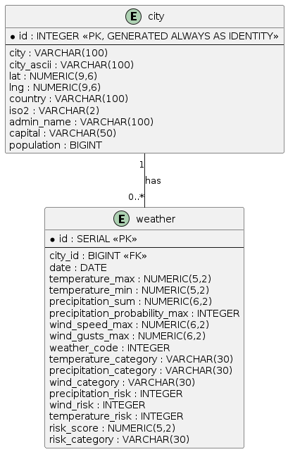
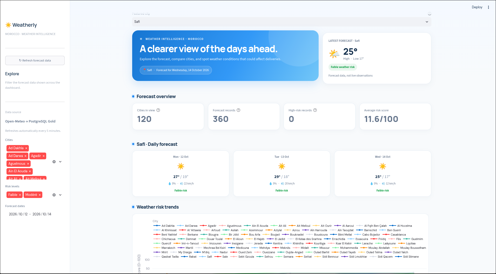
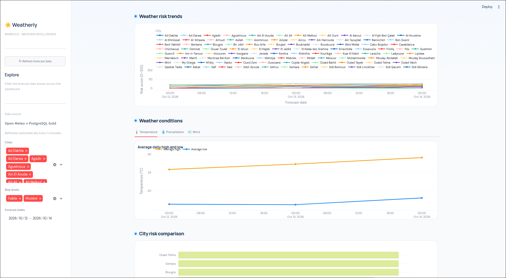
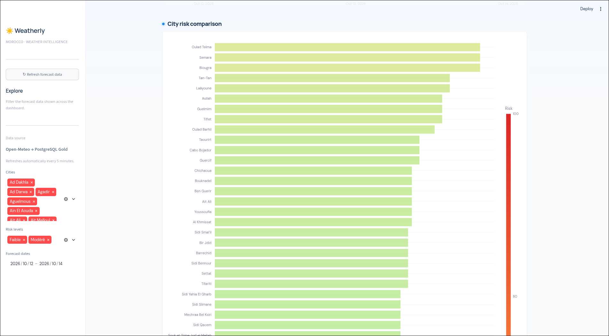
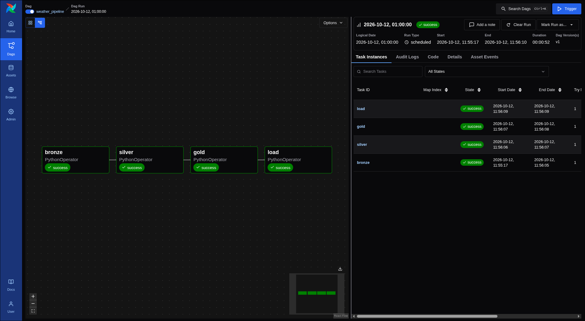

# Weatherly

## Morocco Weather Intelligence and Delivery-Risk Pipeline

Weatherly is an end-to-end data platform that turns short-term weather forecasts for Moroccan cities into delivery-oriented risk indicators. It extracts city and forecast data, processes it through a Bronze/Silver/Gold pipeline, loads the result into PostgreSQL, and presents the latest forecast in an interactive Streamlit dashboard.

The project answers a practical operational question:

> Which Moroccan cities and forecast dates may present the highest weather-related delivery risk?

The risk score is a decision-support estimate based on forecast variables. It is not an official meteorological warning.

## What the project provides

- Three-day weather forecasts for the cities in `sources/ma.csv`.
- Raw source preservation in a Bronze layer.
- Clean, validated city-day records in a Silver layer.
- Business features and a 0-100 weather risk score in a Gold layer.
- PostgreSQL tables for city metadata and forecast analytics.
- A daily Airflow DAG that runs `bronze -> silver -> gold -> load`.
- A Streamlit dashboard for filtering cities, dates, and risk levels.
- CSV export of the filtered forecast shown in the dashboard.

## Architecture

```text
sources/ma.csv
       |
       v
Bronze: city copy + raw Open-Meteo responses
       |
       v
Silver: flattened and validated city-day weather records
       |
       v
Gold: categories, component risks, and weighted risk score
       |
       v
PostgreSQL: city and weather tables
       |                         |
       v                         v
Airflow orchestration       Streamlit dashboard
                             Plotly analysis and CSV export
```

The containerized stack includes:

| Service | Role | Default URL |
| --- | --- | --- |
| `postgres` | Stores city and forecast data | `localhost:5432` |
| `pgadmin` | PostgreSQL administration UI | `http://localhost:5050` |
| `dashboard` | Streamlit weather intelligence UI | `http://localhost:8501` |
| `airflow` | Schedules and runs the ETL DAG | `http://localhost:8080` |
| `app` | Python runtime for the project files | Internal container |



## Data flow

### 1. Bronze: extraction

`extraction/bronze.py` reads the Moroccan city catalog from `sources/ma.csv`, stores a copy at `data/bronze/cities/cities.csv`, and calls the [Open-Meteo Forecast API](https://open-meteo.com/en/docs) for each city.

Each request asks for three forecast days and the following daily variables:

- Maximum and minimum temperature.
- Precipitation sum and maximum precipitation probability.
- Maximum wind speed and wind gusts.
- Open-Meteo weather code.

The raw responses are preserved in `data/bronze/weather/weather.json`.

### 2. Silver: cleaning and normalization

`transformation/silver.py` flattens Open-Meteo's nested `daily` response into one row per city and forecast date. It then:

- Converts dates to datetime values.
- Removes duplicate records.
- Rejects rows where minimum temperature exceeds maximum temperature.
- Removes missing values.
- Rejects negative precipitation and wind values.

Output: `data/silver/weather_clean.csv`.

### 3. Gold: feature engineering and risk scoring

`transformation/gold.py` adds temperature, precipitation, and wind categories, plus a component risk score for each factor.

The final score is calculated as:

```text
risk_score = precipitation_risk * 0.40
           + wind_risk          * 0.35
           + temperature_risk   * 0.25
```

Each component is scored from 0 to 100. The resulting score is classified as:

| Score | Category |
| ---: | --- |
| `< 25` | `Faible` |
| `25-49` | `Modéré` |
| `50-74` | `Élevé` |
| `>= 75` | `Très élevé` |

Output: `data/gold/weather_gold.csv`.

### 4. Load: PostgreSQL

`load/load.py` inserts the Gold data into PostgreSQL:

- `city` stores city identity, coordinates, country, administrative area, capital status, and population.
- `weather` stores one forecast record per city and date, including measurements, categories, component risks, and the final risk classification.
- A unique constraint on `(city_id, date)` prevents duplicate forecast records.

The database schema is created from `sql/schema.sql`. `sql/init.sql` creates the separate `airflow` database used by Airflow.

## Dashboard

The Streamlit application is implemented in `dashboard/app.py` and reads Gold records from PostgreSQL. It provides:

- Featured-city forecast summary with high/low temperature and risk level.
- KPI cards for cities in view, forecast records, high-risk records, and average risk score.
- Daily forecast cards with precipitation probability and wind speed.
- Weather risk trends across the selected cities.
- Temperature, precipitation, and wind analysis tabs.
- City risk comparison ranked by average risk score.
- A detailed filtered forecast table.
- Download of the current filtered view as `morocco_weather_forecast.csv`.
- Cached database reads with a five-minute TTL and a manual refresh control.

### Dashboard screenshots

#### Forecast overview



#### Trends and weather conditions



#### City risk comparison



### Airflow run

The DAG is configured with a daily schedule and `catchup=False`. The screenshot below shows a successful run with all four tasks completed in sequence.



## Repository structure

```text
.
├── dags/
│   └── main.py                  # Airflow DAG
├── dashboard/
│   └── app.py                   # Streamlit dashboard
├── data/
│   ├── bronze/                  # Raw and source-aligned data
│   ├── silver/                  # Clean city-day records
│   └── gold/                    # Business-ready forecast features
├── extraction/
│   └── bronze.py                # City ingestion and API extraction
├── transformation/
│   ├── silver.py                # Flattening and validation
│   └── gold.py                  # Categories and risk scoring
├── load/
│   └── load.py                  # PostgreSQL loading
├── sources/
│   └── ma.csv                   # Moroccan city input catalog
├── sql/
│   ├── init.sql                 # Airflow database initialization
│   └── schema.sql               # Weather warehouse schema
├── screenshots/                 # Dashboard and pipeline captures
├── UML/
│   └── UML.png                  # Architecture diagram
├── Dockerfile
├── Dockerfile.airflow
├── docker-compose.yml
├── requirements.txt
├── .env.example
└── README.md
```

## Quick start with Docker

### Prerequisites

- Docker Engine with Docker Compose.
- Internet access during extraction so the Open-Meteo API can be reached.
- Git, if cloning the repository.

### 1. Clone the repository

```bash
git clone https://github.com/yakhlafhoussam/Weather-Pipeline.git
cd Weather-Pipeline
```

### 2. Configure environment variables

Create a local `.env` file from the included template:

```bash
cp .env.example .env
```

The template defines the PostgreSQL credentials and exposed ports:

```dotenv
POSTGRES_DB=weather_db
POSTGRES_USER=weather_user
POSTGRES_PASSWORD=password
POSTGRES_PORT=5432
AIRFLOW_UID=1000
PGADMIN_DEFAULT_EMAIL=email@email.com
PGADMIN_DEFAULT_PASSWORD=password
PGADMIN_DEFAULT_PORT=5050
STREAMLIT_PORT=8501
```

Change the example passwords before using the stack outside local development. Do not commit `.env` or real credentials.

### 3. Build and start the stack

```bash
docker compose build
docker compose up -d
docker compose ps
```

Open the interfaces:

- Dashboard: [http://localhost:8501](http://localhost:8501)
- Airflow: [http://localhost:8080](http://localhost:8080)
- pgAdmin: [http://localhost:5050](http://localhost:5050)

The actual host ports come from `.env`, so update the URLs if those values are changed.

### 4. Run the pipeline

Airflow starts in standalone mode and loads the `weather_pipeline` DAG. Trigger it from the Airflow UI, or use the Airflow container:

```bash
docker compose exec airflow airflow dags list
docker compose exec airflow airflow dags trigger weather_pipeline
```

The task order is:

```text
bronze -> silver -> gold -> load
```

After a successful run, refresh the dashboard if it was already open.

### 5. Inspect logs and stop the stack

```bash
docker compose logs -f airflow
docker compose logs -f dashboard
docker compose down
```

To remove the PostgreSQL volume and start with an empty database, use this only when the stored data can be discarded:

```bash
docker compose down -v
```

## Running pipeline stages locally

The stage functions are exposed by the project modules and are called by Airflow. From the repository root, the equivalent sequence is:

```python
from extraction.bronze import run_bronze
from transformation.silver import run_silver
from transformation.gold import run_gold

run_bronze("sources/ma.csv", "data/bronze")
run_silver(
    "data/bronze/weather/weather.json",
    "data/silver/weather_clean.csv",
)
run_gold(
    "data/silver/weather_clean.csv",
    "data/gold/weather_gold.csv",
)
```

The PostgreSQL loader expects the Airflow container paths `/opt/airflow/data/...` and a reachable service named `postgres`, so the Docker/Airflow execution path is the supported end-to-end load workflow.

## Useful SQL checks

Connect to the `weather_db` database with the credentials in `.env`, then inspect the loaded data:

```sql
SELECT COUNT(*) FROM city;

SELECT COUNT(*) FROM weather;

SELECT city.city, weather.date, weather.risk_score, weather.risk_category
FROM weather
JOIN city ON city.id = weather.city_id
ORDER BY weather.risk_score DESC
LIMIT 10;
```

## Technology stack

| Technology | Purpose |
| --- | --- |
| Python | Extraction, transformation, and loading code |
| Pandas | Tabular cleaning and feature engineering |
| Requests | Open-Meteo API requests |
| Open-Meteo | Weather forecast source |
| PostgreSQL | Persistent analytical storage |
| psycopg | PostgreSQL connectivity |
| Apache Airflow | Scheduling and orchestration |
| Streamlit | Interactive dashboard |
| Plotly | Dashboard charts |
| Docker Compose | Local multi-service environment |

## Data and operational notes

- Open-Meteo forecast data is external and can change between pipeline runs.
- The Bronze layer is intentionally retained to make the source response inspectable.
- The Gold risk score is a transparent weighted heuristic, not a machine-learning prediction.
- The dashboard explicitly labels its data as forecast data, not live observations.
- The PostgreSQL volume is persistent across normal `docker compose down` and `up` cycles.
- The Open-Meteo API and the city catalog should be treated as external dependencies when deploying this project.
